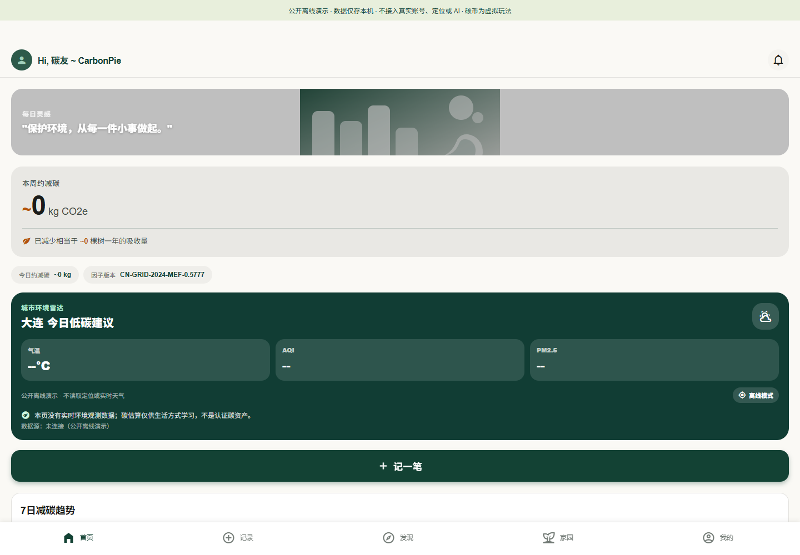

# CarbonPie · 碳果派

把生活方式记录、碳估算、科普阅读与虚拟家园串在一起的低碳生活原型。仓库同时保存 **Expo / React Native 主应用**与 **微信原生小程序**，两者独立实现，不互相覆盖源码或冒称功能完全一致。



[在线游客体验](https://yangwei251003.github.io/carbonpie/) · [两个版本与差异](docs/project-family.md) · [许可与来源](THIRD_PARTY_NOTICES.md) · [实际验证](docs/release-validation.md)

## 可以体验什么

- 在本机记录步行、骑行、公交、节电、光盘等行为，按公开展示的参数计算生活方式估算值。
- 本机保存记录、查看汇总、阅读随包科普文章，并体验虚拟家园与任务奖励。
- 主应用有拍照打卡、影像册、周报、社交和远程 AI 等源代码；其中需要平台权限或云端服务的部分有额外前提，不能把入口存在当成已上线。
- 微信版本保留当前工作增量，包括农场、AI 指南、资料页、文章与微信登录云函数适配。

项目处于**开发中**。当前依赖报告仍有已知工具链告警，见 [依赖状态](docs/security-status.md)，不能视为生产安全认证。默认公开模式不读取设备位置、不请求实时天气/外部图片、不接原账号、数据库或远程模型；AI 和登录页面明确说明未接入，不收集真实密钥/密码。数据只在当前浏览器或设备保存，清除浏览器数据会丢失记录。碳币仅为虚拟游戏数值，不能交易、兑现，也不是认证碳资产。

## 最快运行 · Web

需要 Node.js 24 LTS 与 npm。首次安装需要网络，不需要 .env、服务账号或付费密钥。

```sh
npm ci
npm run web -- --localhost
```

按终端地址打开。默认 PUBLIC_OFFLINE_DEMO 开启；不填写私人资料。生产静态成品与回归：

```sh
npm test
npm run typecheck
npm run export:web
node scripts/check-web.mjs
```

浏览器回归需要已安装 Google Chrome，使用隔离无头窗口和虚构记录。export:web 会忽略本地 .env，移除服务环境变量，强制离线演示，并生成适合 `/carbonpie/` 的静态目录 dist。GitHub Pages 部署的是这份真实 Web 应用，包含同一碳估算和本机存储实现，**不包含 Supabase/Deno 后端**。

客户端采用单页导航，404.html 用于 GitHub Pages 子路径刷新恢复。直接访问深层路由时服务器可能返回 404 状态，随后客户端恢复界面；首页预览入口为正常 200。没有把它当成服务端渲染/SEO 方案。更名仓库时需一起修改构建脚本中的 baseUrl。

## 移动端与微信

主应用使用 Expo SDK 52、React Native 0.76、React 18、Expo Router、React Native Paper、SQLite / Web LocalStorage。Android/iOS 功能需要匹配 SDK 的开发构建、模拟器或真机；不能假定最新 Expo Go 支持这个历史 SDK。本轮没有安装真机、生成发行包、签名或操作应用商店。eas.json 保留构建方案，账户相关 CLI 从普通依赖安装中分离，需要时按 Expo 官方文档独立配置；没有提交密钥或云端账号。

微信目录可在微信开发者工具导入 `wechat-miniapp`。appid 是游客占位，基础页面本机预览与真实发布能力受平台限制。默认 utils/config.js 为 offlineDemo 且空云端配置；开启平台功能需自己的合法 AppID、域名与服务端。Node 测试覆盖本机存储/奖励与不触发网络、定位的边界，**不是微信开发者工具或真实微信运行验收**。

## 需要后端的功能

`supabase/schema*.sql` 是结构、策略和函数定义，不含生产数据转储。它们需要独立的 Supabase/PostgreSQL 项目按依赖顺序应用；请只对专用开发环境操作。

`supabase/functions` 保存碳服务、AI 文章和微信登录适配源码，使用服务器环境变量。服务端 secret/service_role、微信 Secret、模型 Key 应只存在于服务端，不能放进 EXPO_PUBLIC_* 或客户端配置。Supabase publishable/anon 是设计上可公开的客户端身份，仍需要正确 RLS/授权；本仓库不附带原账号的任何钥或项目地址。

若在私有开发环境主动关闭公开模式，可设置 EXPO_PUBLIC_OFFLINE_DEMO=0 并按 .env.example 配置自己的客户端 public/anon 服务项。真实认证、RLS、云同步、邮件、存储、模型和微信 code 换会话均需单独验收。当前 wx-login 只返回身份信息，没有提供可证明后续 RLS 会话授权的完整登录闭环；不得直接投入真实用户使用。

## 参数、素材与目录

电力参数 0.5777 kg CO₂e/kWh 对应[生态环境部等发布的 2024 年全国电力平均碳足迹因子](https://www.mee.gov.cn/xxgk2018/xxgk/xxgk01/202510/t20251024_1130734.html)。本项目把它用于典型行为的简化估算；公交/步行/饮食与待机等还包含原型假设，不是个体实测、核证减排或全生命周期审计。微信与主应用的参数不同，见 [方法边界](docs/methodology.md)，不混加两端结果。

界面场景为项目 SVG 代码，新增应用/Tab 图标为几何示意图；必要 Material Design Icons 字体保留上游许可。来源不明应用图、未确认许可的远程照片不随公开成品加载。Pixabay 仅为默认关闭的可选适配器，需使用者自行核对账号及图片条款。

```text
app/                   Expo Router 页面
src/features/          估算、照片、科普、家园与服务适配
src/lib/               本机数据、身份与云同步边界
assets/                必要许可字体与新增几何图标
wechat-miniapp/        独立微信原生版本
supabase/              数据结构与尚待独立验收的服务器函数
tests/                 估算、输入与微信存储夹具测试
scripts/               安全静态导出、浏览器回归及原部署辅助源码
docs/                  项目关系、方法学、验证与后续事项
third-party/           原许可文本与依赖索引
```

## 更新与后续计划

本轮保存本地未提交业务增量，清空个人服务配置，移除 Supabase 本地链接缓存与手动内容注入，新增离线模式/静态体验，修复无效数值可进入估算或虚拟奖励的问题。原始历史不随新公开快照发布。详见 CHANGELOG.md。

后续优先核对两端估算口径，完善服务器授权和独立环境测试，验证微信/Android/iOS 实机，再考虑发布原生包。自有代码与文档采用 MIT；第三方许可继续有效。原目录还保留私人服务链接、未清权/未核验内容和原 Git 历史，**当前不可本地删除**。
